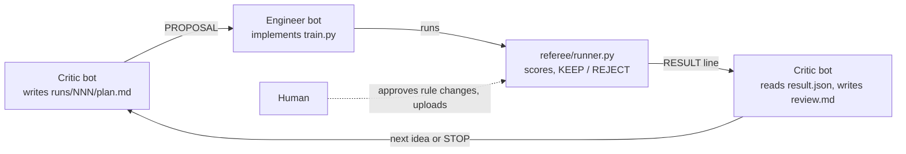
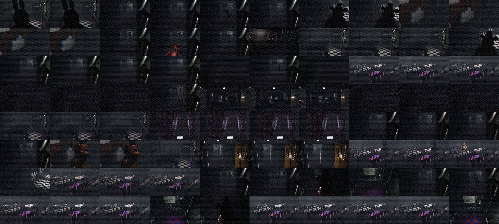

# Five Nights with AI: Track 4, Best Use of GrokBots

Two GrokBots, an **Engineer** and a **Critic**, worked as a small ML team on the competition's anomaly-detection task (the Track 1 dataset: is anything wrong in a 10-frame security-camera sequence?).
The Critic planned and reviewed every experiment. The Engineer built and ran the code. A referee script did all the scoring, so neither bot could grade its own work. A human stepped in a handful of times, and every intervention is logged.

In under two and a half hours (12:59 to 15:22 PDT) the bots ran 7 rounds and took out-of-fold F1 from 0.674 to **0.886** (AUC 0.80 to 0.96). Their final submission scored **0.8899** on the live Track 1 leaderboard.

## How the bots work together



| | job | not allowed |
|---|---|---|
| **Critic bot** ([`bots/CRITIC.md`](bots/CRITIC.md)) | reads results and error analysis, opens frames, writes `plan.md` before any code, writes `review.md`, decides the next idea or STOP, writes the final [`report.md`](report.md) | writing or running training code |
| **Engineer bot** ([`bots/ENGINEER.md`](bots/ENGINEER.md)) | builds feature extractors, copies the parent `train.py` and changes only what the plan says, runs the referee, fixes bugs on a failed run | changing the hypothesis, writing scores, uploading |
| **Referee** ([`referee/runner.py`](referee/runner.py)) | the only scorer: frozen 5-fold split and labels hashed at `init`, 900 s and 3 attempts per run, a hard deadline; picks the threshold; KEEP only if F1 beats the best run by at least 0.002; writes [`best/`](best/) and the [`events.jsonl`](events.jsonl) ledger | |
| **Human** | approves the contract, authorizes deadline or limit changes, uploads | |

Both bots follow one shared [`PROTOCOL.md`](PROTOCOL.md). Files are the source of truth; chat is only for short handoffs: `PROPOSAL`, the verbatim `RESULT` line, `WAITING_FOR_APPROVAL`, `GIVE_UP` and `STOP`. The kit's setup guide (in Chinese) is [`README_zh.md`](README_zh.md).

## What the bots did

| run | time (PDT) | Critic's hypothesis | OOF F1 | referee |
|---|---|---|---|---|
| [001](runs/001) | 13:02 | baseline: pixel median-deviation stats + gradient boosting | 0.6742 | KEEP |
| [002](runs/002) | 13:32 | compare each frame to a per-camera normal reference | 0.7279 | KEEP |
| [003](runs/003) | 13:56 | higher-resolution thumbnails for small, dark figures | 0.7283 | REJECT (+0.0004 < 0.002) |
| [004](runs/004) | 14:55 | pivot: frozen ResNet18 frame embeddings | 0.8526 | KEEP |
| [005](runs/005) | 15:10 | add each frame's offset from its nearest normal frames | 0.8731 | KEEP |
| [006](runs/006) | 15:15 | linear to gradient-boosted frame scorer | **0.8865** | KEEP (final) |
| [007](runs/007) | 15:22 | fine-tune ResNet18 layer4 | - | not run: time gate failed |

Predicting "anomaly" for every sequence already gives F1 0.667, so that is the bar the bots had to beat.

**Moments worth looking at**
- **The Critic looked at the data, not just the numbers.** Run 001 barely beat the all-anomaly baseline. The Critic opened frames from 8 sequences and found that one sequence mixes several cameras, so "distance from the sequence median" was measuring camera switches. That finding became run 002 ([review 001](runs/001/review.md)). After 002 it built the contact sheet below from the missed anomalies and saw that they were small, dark figures ([review 002](runs/002/review.md)).
- **It caught a fake improvement.** Run 003 raised recall, but the Critic checked AUC (0.7977 vs 0.7983) and concluded that only the threshold had moved, not the separation. The referee rejected the run ([review 003](runs/003/review.md)).
- **The pivot.** In a strategic review the human asked for, the Critic called runs 001-003 "local optimization inside the wrong representation" and proposed frozen ResNet18 embeddings. That was the biggest single gain, 0.728 to 0.853 ([plan 004](runs/004/plan.md)).
- **The referee held the line.** After the deadline was moved, the runner refused to score run 004 because `contract.json` no longer matched its frozen hash. The bot stopped instead of working around it and asked the human, who authorized the hash update (`REFUSED` in [`events.jsonl`](events.jsonl), [notes 004](runs/004/notes.md)).
- **Time gates kept the bots honest about the clock.** Run 004's first extraction projected 54 minutes against a 12-minute gate. The loader was fixed (parallel decoding, fp16 on the Mac GPU) to bring it down to 8.8 minutes without changing the idea. Fine-tuning in run 007 projected 54.5 minutes, so it was dropped rather than swapped for an untested idea, and the Critic posted STOP ([notes 007](runs/007/notes.md)).
- **An old idea came back in a better form.** Run 005 re-applied run 002's "compare to this camera's normal frames" idea in embedding space ([plan 005](runs/005/plan.md)).


*The Critic's contact sheet after run 002: 8 anomalous sequences, one per row, 10 frames each, mostly ones the model missed. Cameras change within a row, and the figures are small and dark.*

**Human interventions** (from [`report.md`](report.md)): amended run 002's design (split the normal sequences into a reference half and a classifier half), moved the exploration deadline twice with a logged hash update each time, raised run 004's extraction-time limit to 20 minutes, asked for the strategic review before run 004, and did all uploads. Authorizations are quoted with timestamps in the run notes, for example [notes 004](runs/004/notes.md).

## Final model (run 006)
1. **Frozen ResNet18 frame embeddings** ([`features/r18emb_v1.py`](features/r18emb_v1.py)): ImageNet weights, 224x128 input, one 512-d vector per frame, no labels used.
2. **Distance from normal** ([`runs/006/train.py`](runs/006/train.py)): scaler and PCA(128) inside each fold. Half of the normal training sequences form a reference bank, and each frame gets its offset and distance to its 5 nearest normal frames.
3. **Frame scorer**: HistGradientBoosting on 257 features per frame. A sequence's score is the max over its 10 frames.
4. **Threshold** picked by the referee on out-of-fold predictions (0.83) and applied to the mean of the 5 fold models on test. Output: [`best/submission.csv`](best/submission.csv).

## Repo map
- [`PROTOCOL.md`](PROTOCOL.md), [`bots/`](bots/): the shared rules and the two bot prompts
- [`referee/`](referee/): runner, contract and frozen split (labels are not committed)
- `runs/NNN/`: `plan.md` (Critic, written before code), `train.py` (Engineer), `notes.md`, `review.md` (Critic), runner output and logs
- [`features/`](features/): label-free feature extractors
- [`templates/`](templates/), [`examples/make_digits_task.py`](examples/make_digits_task.py): the kit is task-agnostic, and the digits example is a smoke test on sklearn digits
- [`best/`](best/), [`events.jsonl`](events.jsonl): written only by the runner

Internal files call the task `fnaf-track1` because the bots worked on the Track 1 dataset and leaderboard. The frozen contract and its hashes are left as they were.

## Reproduce
Needs the official starter kit and data: https://github.com/acmucsd/Five-Nights-With-AI-Starter-Kit

```bash
python3 -m venv venv && venv/bin/pip install numpy pandas pillow scikit-learn joblib matplotlib torch torchvision
venv/bin/python fnaf/make_task.py <starter-kit>/data task   # rebuilds task/*.csv (labels are not committed)
venv/bin/python features/r18emb_v1.py                       # caches embeddings in cache/ (about 1 GB, ~15 min on an M1 Mac)
```
Then `referee/runner.py run runs/006` trains run 006 (`train.py` reads its inputs from environment variables the runner sets), picks the threshold and writes `best/submission.csv`.
This folder is frozen and its contract deadline (2026-10-24 15:50 PDT) has passed, so the runner refuses new runs here by design. To rerun, start a new phase in a fresh copy (without `referee/frozen/`, `best/` and `events.jsonl`): set a new deadline in `referee/contract.json` and run `referee/runner.py init` there, as [`PROTOCOL.md`](PROTOCOL.md) and [`README_zh.md`](README_zh.md) describe.
The bot prompts and a few early scripts use paths from the original setup (`/workspace/...`); adjust them if your layout differs.
